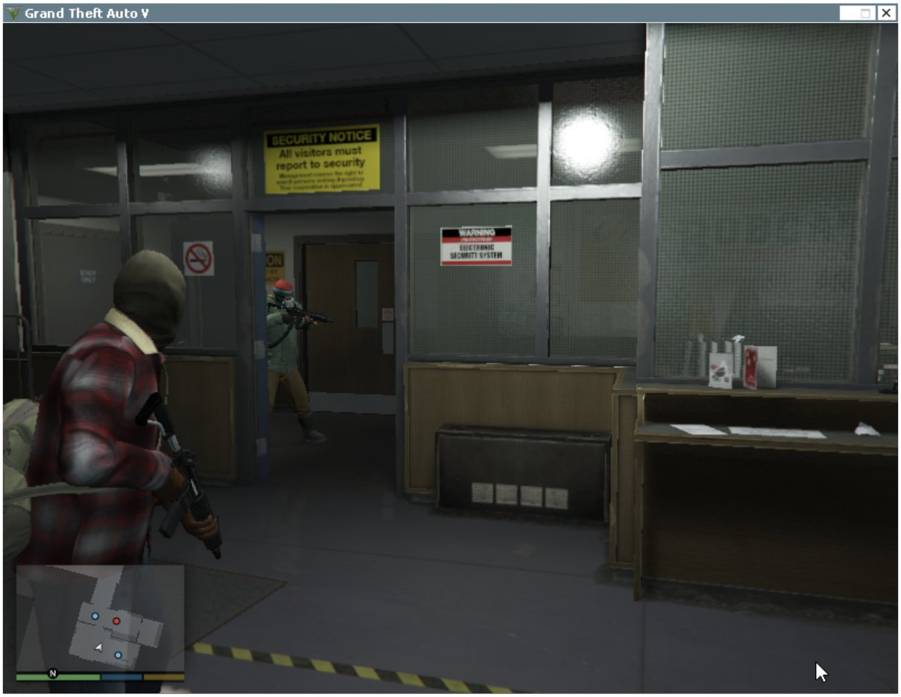
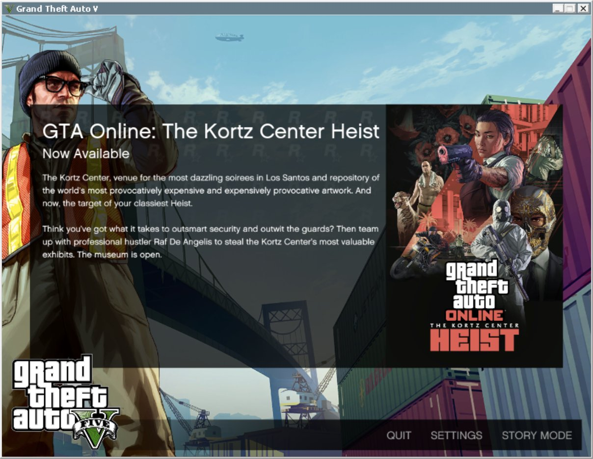
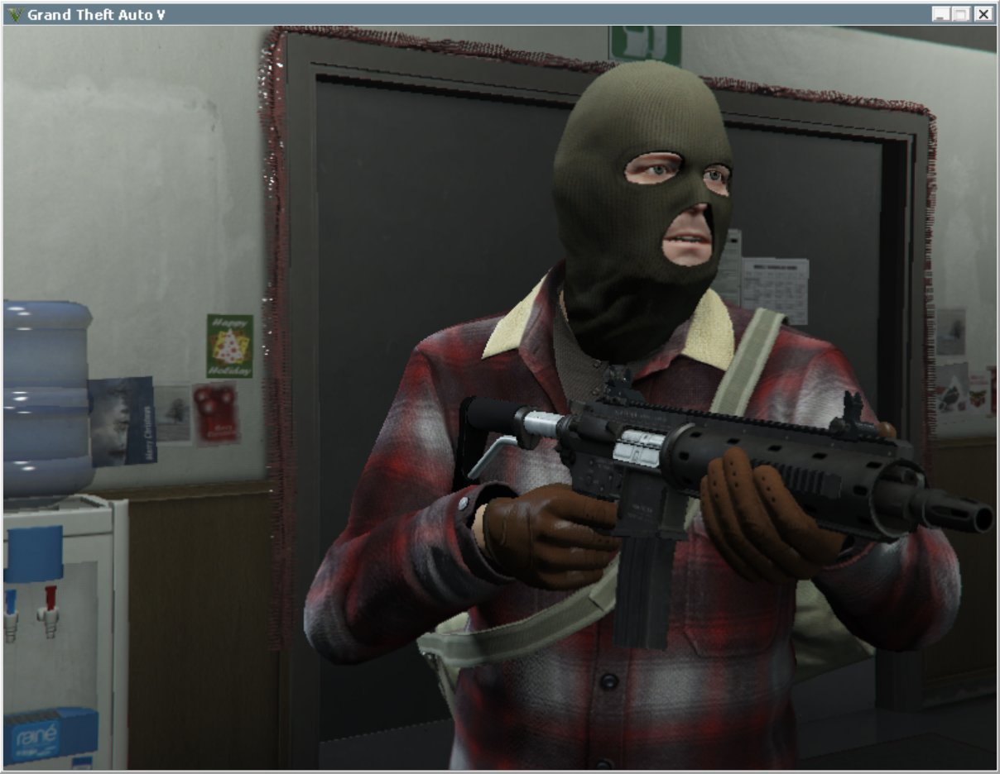

# GTA V on Android (GameNative)

Play **Grand Theft Auto V Legacy** (the Epic Games Store version) in story mode on an Android handheld with
[GameNative](https://github.com/utkarshdalal/GameNative). Out of the box the Rockstar Games Launcher opens but never
starts the game, its sign-in page hangs, and the screen freezes when story mode loads. One small Windows program
from this repo, `EpicGamesLauncher.exe`, plus a few container settings fix that.

| | GTA V Legacy (Epic) |
|---|---|
| Plays | Story mode: the prologue mission, with the player in control |
| Speed | **59.5 FPS** at 1280x720 full screen (borderless, VSync off), median frame 16.8 ms; the game's default (VSync Half) holds it at 30 |
| Controls | The Thor's controller; the touch screen works as a touchpad |
| Online | No. GTA Online needs BattlEye, which does not run here |

| | |
|---|---|
|  |  |

## Status

| | |
|---|---|
| Tested device | AYN Thor (Snapdragon 8 Gen 2, Adreno 740, 16 GB RAM, Android 13), GameNative 1.3.0 |
| Tested game | GTA V Legacy 1.0.3889.0 from the Epic Games Store (Premium Edition), Rockstar Games Launcher 1.0.109.3031, Social Club 2.4.0.240 |
| Works | Rockstar sign-in, the main menu, story mode (the prologue); 3 of 3 starts in a row with v0.1.0 |
| Not tested | Long sessions, missions after the prologue, other devices, the Steam version, GTA V Enhanced |
| Known issues | [Known issues](#known-issues) below |

## What you need

- An Android device with a Snapdragon / Adreno GPU and GameNative 1.3.0. Only the AYN Thor was tested.
- GTA V on the Epic Games Store, signed in inside GameNative, and a Rockstar Games account linked to that Epic
  account. The download is 117 GB (about 120 GB on disk).
- [`EpicGamesLauncher.exe`](https://github.com/tarikbc/gtav-android/releases/latest/download/EpicGamesLauncher.exe)
  from the latest release (170 KB). It is built from [`tools/launcher/egl.c`](tools/launcher/egl.c).

## Setup

### 1. Put the launcher in the Download folder

Create the folder `Download/gtav-android` on the device and put `EpicGamesLauncher.exe` in it. GameNative maps the
Download folder to drive `D:`, so the file is `D:\gtav-android\EpicGamesLauncher.exe` inside Wine.

Do not put it in the game folder: started from there (drive `A:`), it dies at once inside the emulator.

### 2. The container

Open GTA V in GameNative's Epic library, tap the **cog** next to Play, then **Edit container**. Set:

| Tab | Setting | Value |
|---|---|---|
| General | Container Variant | `bionic` |
| General | Wine Version | `proton-11.0-99-arm64ec-1` |
| General | Executable Path | `D:\gtav-android\EpicGamesLauncher.exe` |
| General | Disable Epic Overlay | **on** |
| Graphics | Graphics Driver / Version | `Wrapper` / `turnip_v26.0.0_R6` |
| Graphics | DX Wrapper | `DXVK` (2.4.1 gplasync) |
| Emulation | 64-bit Emulator | `FEXCore` |
| Emulation | FEXCore Version / Preset | `2605` / `INTERMEDIATE` |
| Power Control | GPU power level min / max | `8` / `8` (the top clock), CPU left free |

Then tap **Save**. The Power Control values are the single biggest gain measured (+22 % overall): the GPU governor
otherwise keeps the clock low because the game looks only half busy to it. The same profile as a file is
`tools/scripts/power-profile-gpu-max.json` (`.config/.power-profile` in the container's home; see
[PERFORMANCE.md](docs/how-it-works/PERFORMANCE.md)). GameNative's own choice for this game (Box64 with an x86-64 Proton) fails: the Rockstar launcher
stops with "Failed to connect to the Rockstar Games Library Service".

What `EpicGamesLauncher.exe` does at each start ([EPIC-LAUNCH.md](docs/how-it-works/EPIC-LAUNCH.md)):

1. It starts the game as the Epic Games Launcher would, so the Rockstar launcher accepts the Epic launch.
2. It adds `-nobattleye`, without which the game ends when story mode loads. A container variable
   `EPIC_EXTRA_ARGS` replaces that default.
3. It patches Social Club's `libcef.dll` once (4 bytes and two strings, a backup stays as `libcef.dll.orig`), so the
   Rockstar sign-in page loads and Social Club renders in software, without its crashing GPU helper
   ([CEF-PATCHES.md](docs/how-it-works/CEF-PATCHES.md)). It patches only the known version
   and leaves any other alone.
4. It watches GameNative's X server and unfreezes it when Social Club stops reading
   ([X-SERVER-FREEZE.md](docs/how-it-works/X-SERVER-FREEZE.md)). `XWATCH=0` turns this off.
5. It keeps `GTA5.exe` on the fast cores. Android's scheduler sometimes parks the game's heaviest threads on the
   slow cores for a whole session, which halves the frame rate; GameNative's own pin does not reach the game because
   the Rockstar launcher starts it. `GTA_PIN_MASK` sets the core mask (hex, default `f8` = cpu3 to cpu7 on an
   8-core SoC; `0` turns the pin off). It also parks the Rockstar launcher and the Social Club helpers on the slow
   cores at low priority while the game runs (`GTA_SC_MASK`, default `07`, `0` turns it off): the Social Club
   overlay's web renderer alone took 59 % of a fast core during a benchmark.

Its log is `C:\users\xuser\AppData\Local\Temp\EpicGamesLauncher.log`. It never writes the Epic login arguments.

### 3. First start

1. Tap Play. The Rockstar Games Launcher installer opens: accept the terms and install. The launcher then installs
   Social Club and may close; tap Play again. This second start applies the `libcef.dll` patch.
2. The Rockstar sign-in window opens. Sign in with your Rockstar account and tick **Auto Sign In**, so later starts
   skip this window. Rockstar may send a code to your email.
3. The game starts after about a minute. On the first start it shows **Display Calibration**; press Enter (or A).
4. In the main menu open **SETTINGS → Graphics** and set **Screen Type: Windowed Borderless**, **Resolution:
   1280x720**, **VSync: Off**. The game picks VSync Half (30 FPS) on its own, and in exclusive fullscreen it
   minimizes itself whenever Android takes the focus. The same values in
   `Documents\Rockstar Games\GTA V\settings.xml`: `Windowed` 2, `ScreenWidth` 1280, `ScreenHeight` 720, `VSync` 0.
5. Back in the main menu, choose **STORY MODE**.

## What to expect

One 60 s window each in the prologue, player standing still, frame times from Android's compositor
([TESTING.md](docs/guides/TESTING.md)):

| Game settings | FPS | mean frame | median | p99 | worst | over 50 ms | over 100 ms |
|---|---|---|---|---|---|---|---|
| Defaults: 800x600 window, VSync Half | 31.3 | 32.0 ms | 33.4 ms | 33.4 ms | 50.1 ms | 19 | 0 |
| 1280x720 borderless, VSync Off | **59.5** | 16.8 ms | 16.8 ms | 42.1 ms | 134.8 ms | 20 | 3 |

At 59.5 FPS the GPU is about 75 % busy and the CPU about 71 %, at 86 to 88 °C with the fan on Custom.

The game's built-in benchmark (`-benchmark -benchmarkFrameTimes` in `commandline.txt`, all settings Low, 1280x720)
drives through the city for five passes. Only pass 4 (117 s, 4000+ frames) repeats within a few percent; passes
0 to 3 last 10 s each and swing two to one between identical runs, so they are noise. Pass 4 and the overall FPS:

| Change | Pass 4 FPS | Pass 4 median | Overall FPS |
|---|---|---|---|
| Container as above, GPU governor default, no pin | 42.1 | 23.9 ms | 38.6 |
| GPU at its top clock (Power Control 8 / 8) | 48.6 | 19.2 ms | 47.0 |
| GPU top clock and the launcher's core pin (three runs) | 48.6 to 57.3 | 17.6 to 20.1 ms | 41.0 to 51.0 |
| GPU top clock, core pin and the Rockstar tree parked on the slow cores | **56.4** | **19.6 ms** | **46.2** |
| Same, with `FEX_TSOENABLED=0` in the container variables | **57.1** | **18.6 ms** | **48.9** |
| Same, TSO at its default | 52.5 | 19.2 ms | 40.4 |
| Same, TSO default, Social Club rendering in software (v0.2.1 launcher) | **55.4** | **18.7 ms** | **48.7** |
| Same at **1920x1080** (container Screen Size 1920x1080, game 1920x1080 fullscreen) | 50.1 | 19.5 ms | 46.6 |

Runs of one configuration differ by up to 10 % (Android's memory and scheduler state), so one run is a hint, not a number.
Full HD costs about 10 % of pass 4 (one run), because the CPU side sets the frame rate, not the GPU; set the container's
Screen Size to 1920x1080 and pick 1920x1080 in the game. Free memory fell to 3.3 GB in that run (4 GB at 720p) and one
of two Full HD sessions was killed by Android about 90 s into the game, so 1280x720 stays the safe default.
`FEX_TSOENABLED=0` (FEX drops x86 memory ordering) gave the best run and four times fewer long frames, but the game ended
once in pass 2 of about ten runs with it; add it as a container variable if you accept that. `WINEESYNC=1` (GameNative's
default) must stay: without it the game runs at 5.7 FPS.
[PERFORMANCE.md](docs/how-it-works/PERFORMANCE.md) has every run, what did not help (a native ARM64EC DXVK, FEX
with TSO off) and where the main thread's time goes.

## Known issues

- **GTA V stops drawing when it loses the focus** (Android's quick settings, a console window in Wine) and shows its
  pause menu when it gets it back; press Start (or Esc). Quick settings also pause GameNative itself: tap its Play
  button. `wfocus.exe` ([TOOLS.md](docs/guides/TOOLS.md)) gives the focus back from adb.
- **White launcher window, "Launch validation had fatal error!"** Social Club's GPU helper crashes a few times while
  the launcher starts. With v0.1.0 that is short (3 of 3 starts worked); if the game does not start, close it in
  GameNative and tap Play again.
- **The screen freezes and Android says "GameNative isn't responding".** That is the X server freeze. The launcher
  watches for it; if it still happens, check the log above for `xwatch` lines and tell us in an issue.
- **GTA Online** does not work (BattlEye).
- **GTA V exits by itself right after its built-in benchmark** writes the result; that is normal. Remove the two
  switches from `commandline.txt` after a benchmark session, or every start runs the benchmark.
- **Rockstar asks for an email code at every start** if the launcher's CEF profile
  (`Documents\Rockstar Games\Social Club\Launcher\Renderer`) is removed or renamed: it holds the "remembered
  device" cookies. Never delete it; `tools/scripts/bats/renderer_restore.bat` puts a renamed one back.

## How it was found

What belongs to GameNative rather than to this repo (the X server's blocking writes, the pin that misses launcher-started
games) is drafted in [docs/upstream/REPORTS.md](docs/upstream/REPORTS.md).

[STORY.md](docs/STORY.md) tells the whole path, from a Steam copy that Rockstar would not activate to story mode on
the Epic copy. [TOOLS.md](docs/guides/TOOLS.md) describes the small Windows tools used to look inside the Wine
session while the X server is stuck.

## Building

`tools/build.sh` builds `EpicGamesLauncher.exe` and the probes with mingw-w64 (`brew install mingw-w64`).

## Credits

- [GameNative](https://github.com/utkarshdalal/GameNative), Wine/Proton and [FEX-Emu](https://github.com/FEX-Emu/FEX).
- The fake `EpicGamesLauncher.exe` idea comes from the [Heroic Games Launcher](https://github.com/Heroic-Games-Launcher/HeroicGamesLauncher)
  wiki and [heroic-epic-integration](https://github.com/BananaWorks07/heroic-epic-integration).
- Companion project: [ageofempires-android](https://github.com/tarikbc/ageofempires-android).

GTA V, Rockstar Games and Social Club are trademarks of Take-Two Interactive. This project is not affiliated with them;
it ships no game or Rockstar files, and you need your own copy of the game.
